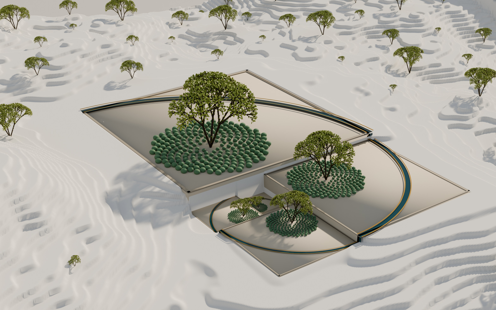
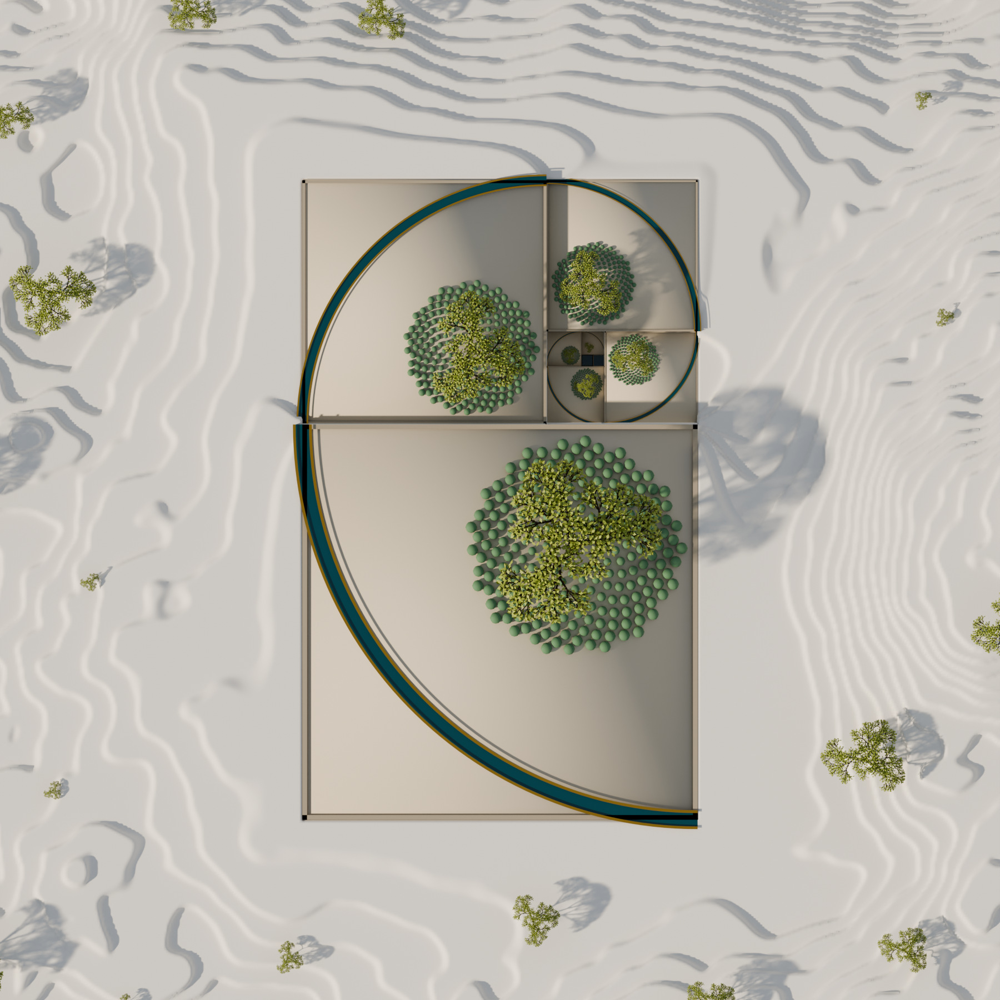

# Fibonacci Terraces / Тераси Фібоначчі

A landscape study made in answer to a brief from a landscape designer who read about
[murmur](../../README.md) and asked how an AI would handle an open design task:

> 1. Алгоритмічна модель: L-системи (Lindenmayer systems)
> 2. Геометричні моделі: спіраль Фібоначчі та золотий перетин
> 3. Фрактальна рекурсія в ландшафті, рельєфна фрактальна композиція





Modelled and rendered in Blender 5.3 (Cycles) by Claude Fable 5.2. The whole scene is
generated by [`landscape.py`](landscape.py); there are no imported models or textures.

## Українською

Я не хотів робити три окремі ілюстрації до трьох пунктів. Я спробував скласти з них один
сад, у якому кожна ідея тримає на собі інші.

**План — прямокутник Фібоначчі.** Ділянка 34 × 55 м поділена на квадрати зі сторонами
1, 1, 2, 3, 5, 8, 13, 21 і 34 м. Кожен квадрат — окрема тераса на своєму рівні. Рівні
опускаються за спіраллю до її «ока», де лежить басейн, тож сад працює як амфітеатр.

**Вода йде золотою спіраллю.** Водний канал у латунній оправі повторює спіраль Фібоначчі
через усі тераси і на кожній межі падає на рівень нижче. Ширина каналу пропорційна
стороні квадрата, тому він звужується до центру в тому самому відношенні φ.

**Дерева — L-система.** Усі дерева виростила одна граматика Лінденмаєра, яку обходить
тривимірна «черепашка»:

```
аксіома:  A
A → [&FL!A]/////[&FL!A]///////[&FL!A]
F → S/////F
S → FL                    кут 22,5°, 7 поколінь
```

Тут є збіг, який мене потішив. Правила `F → SF` і `S → F` — це найперша система
Лінденмаєра 1968 року, і довжини її рядків є числами Фібоначчі. Тобто стовбур кожного
дерева росте тією самою послідовністю, якою розкреслено план.

**Дерево одне, розмірів багато.** На кожній терасі стоїть те саме дерево, зменшене
пропорційно до свого квадрата. Його ж, ще менше, розсіяно за стіною по дикому рельєфу.
Самоподібність тут буквальна: це один організм у різних масштабах.

**Клумби висаджено за золотим кутом.** Під кожним деревом кругла клумба, де рослина
номер n стоїть під кутом n × 137,5° на відстані, пропорційній √n, як насіння в
соняшнику. Рослин 233, це число Фібоначчі, тому в клумбі можна порахувати 13 спіралей
в один бік і 21 в інший.

**Рельєф — фрактальна рекурсія.** Земля навколо згенерована алгоритмом «діамант —
квадрат»: сітку рекурсивно ділять навпіл і на кожному кроці додають шум, удвічі
дрібніший за попередній. Потім рельєф нарізано на горизонталі по 0,6 м, як макет із
картону. Біля саду земля плавно підходить до рівня найближчої тераси.

Головна думка композиції — зустріч двох порядків. Усередині стіни все пораховано, зовні
все випадкове, але обидва підкоряються одному правилу: частина повторює ціле.

Що тут умовність, а не проєкт: рослини справжнього саду не масштабуються разом із
терасою, перепад у 7,6 м потребує сходів і огорож, а воді потрібна інженерія. Це
ілюстрація ідеї, вільна від обмежень, як і просили.

## In English

Rather than three illustrations for three points, this is one garden in which each idea
carries the others.

- **The plan is a Fibonacci rectangle**, 34 × 55 m, divided into squares of side 1, 1, 2, 3,
  5, 8, 13, 21 and 34 m. Each square is a terrace at its own level, and the levels step
  down along the spiral into its eye, where a pool sits.
- **Water follows the golden spiral.** A brass-edged rill traces the Fibonacci spiral across
  every terrace and falls one level at each boundary. Its width is proportional to its
  square, so it narrows toward the centre by φ.
- **The trees are an L-system**, the grammar above, walked by a 3D turtle. Two of its rules,
  `F → SF` and `S → F`, are Lindenmayer's original 1968 system, whose string lengths are the
  Fibonacci numbers, so each trunk grows by the same sequence the plan is drawn with.
- **There is one tree at many sizes.** Each terrace holds the same individual scaled to its
  square, and smaller copies are scattered over the wild land outside the wall.
- **The beds are planted by the golden angle**: plant n at n × 137.5°, at a radius
  proportional to √n, 233 plants to a bed, which gives 13 spirals one way and 21 the other.
- **The relief is fractal recursion**: the diamond-square algorithm, cut into 0.6 m contour
  layers like a card model, and eased to meet the nearest terrace at the garden's edge.

This is an illustration of an idea, not a buildable design. Real plants do not scale with
their terrace, a 7.6 m drop needs stairs and guarding, and the water needs engineering.

## Run it

```sh
pip install bpy numpy
python landscape.py              # both views, full quality (about 11 minutes in all on 4 CPU cores)
PREVIEW=1 python landscape.py    # small and fast
SAVE_BLEND=1 python landscape.py # also write a .blend file to open in Blender
```

Change `SEED` at the top of the script for different land around the same garden.
